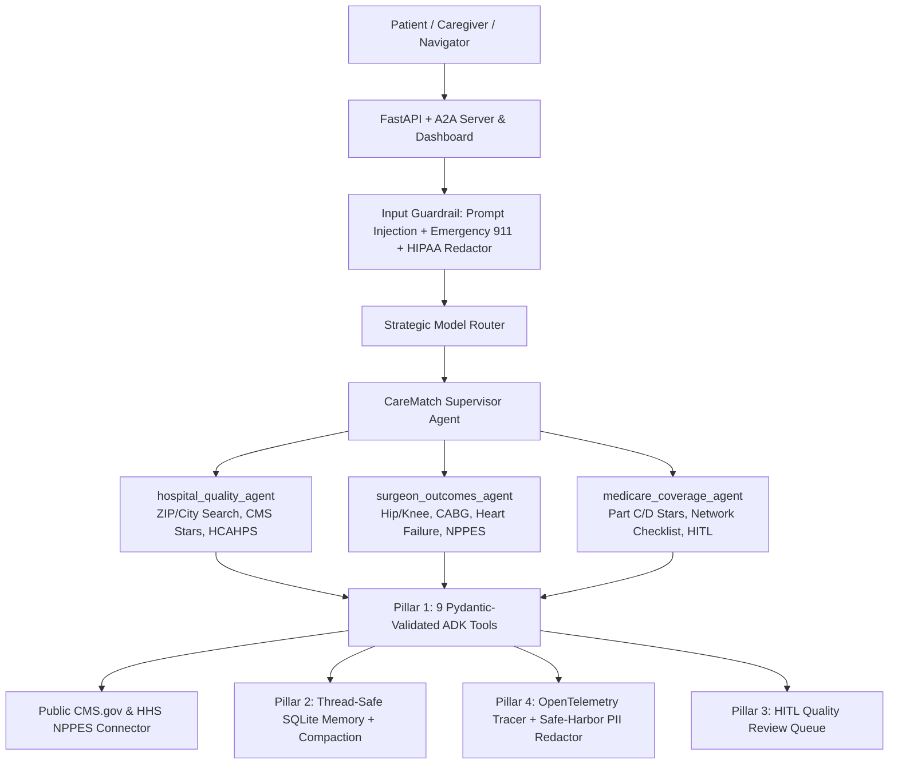

# CareMatch — Autonomous Multi-Agent Healthcare Quality & Coverage Navigator

[](LICENSE)
[](pyproject.toml)
[](app/agent.py)

**CareMatch** is an open-source, multi-agent healthcare navigation system built on the **5-Pillar Production Agent Architecture (95/95 Evaluation Rubric)**. It helps patients, caregivers, and benefits navigators evaluate **CMS Hospital Quality & Safety Ratings**, **procedure-specific outcomes**, **hospital-affiliated surgeons/specialists**, and **Medicare Advantage (Part C) & Part D Star Ratings** using **100% public U.S. federal datasets**.

> **Medical & Coverage Disclaimer:** CareMatch is strictly an educational and informational tool grounded in public federal datasets (CMS.gov and HHS NPPES). It does **not** diagnose medical conditions, recommend clinical treatments, or guarantee real-time insurance network status. In an emergency, call **911** immediately.

---

## Architecture Overview (5-Pillar 95/95 Pattern)



### The 5 Production Engineering Pillars

| Pillar | Weight | Implementation in CareMatch | Key Module(s) |
|---|---:|---|---|
| **1. Tool & Interface Design** | 20/20 | 9 Pydantic v2 validated tools, `TOOL_JSON_SCHEMAS`, structured `recovery_guidance` on invalid args or lookup misses | [app/tools.py](app/tools.py), [tools.py](tools.py) |
| **2. Context & Memory** | 20/20 | Explicit `AGENT_SYSTEM_PROMPT`, thread-safe 4-table SQLite store (`conversation_history`, `session_summaries`, `user_care_notes`, `feedback_log`), rolling token compaction, `AsyncMemoryWorker` | [app/memory.py](app/memory.py), [memory.py](memory.py) |
| **3. Orchestration & Logic** | 20/20 | Supervisor + 3 ADK specialists, `ModelRouter`, `InputGuardrail` (prompt injection + 911 emergency advisory), `OutputGuardrail`, `HITLController` | [app/agent.py](app/agent.py), [app/orchestration.py](app/orchestration.py), [app/resilience_plugin.py](app/resilience_plugin.py) |
| **4. Observability & Safety** | 20/20 | OpenTelemetry spans (`AgentTracer`), structured JSON telemetry, HIPAA Safe-Harbor `PIIRedactor` (SSN, MRN, Medicare MBI, DOB, Email, Phone) | [app/telemetry.py](app/telemetry.py) |
| **5. Infrastructure & Eval** | 15/15 | Non-root `Dockerfile`, Terraform Cloud Run + Secret Manager IaC, GitHub Actions CI, 10-scenario Golden Evaluation Harness & external sanitization test | [terraform/main.tf](terraform/main.tf), [.github/workflows/ci.yml](.github/workflows/ci.yml), [tests/eval/eval_harness.py](tests/eval/eval_harness.py) |

---

## Public Data Provenance (Zero Proprietary Data)

CareMatch relies **exclusively** on publicly documented U.S. federal open data:
1. **CMS Provider Data Catalog — Hospital General Information (`xubh-q36u`)**: `https://data.cms.gov/provider-data/topics/hospitals`
2. **CMS Medicare Care Compare (HCAHPS `dgck-syfz`, Complications & Deaths `ynj2-r877`, Readmissions)**: `https://www.medicare.gov/care-compare/`
3. **HHS NPPES National Provider Identifier (NPI) Registry API v2.1**: `https://npiregistry.cms.hhs.gov/api/?version=2.1`
4. **CMS Medicare Advantage (Part C) & Part D Star Ratings Performance Data**: `https://www.cms.gov/medicare/health-drug-plans/part-c-d-performance-data`

By default (`CAREMATCH_CMS_LIVE_API=false`), CareMatch uses a fast, deterministic curated public CMS snapshot (`app/cms_data.py`) so CI tests and offline demos work without network dependencies. Set `CAREMATCH_CMS_LIVE_API=true` in `.env` to enrich queries live against CMS.gov and HHS NPPES APIs.

---

## Quickstart

### 1. Local Python Setup

```bash
python3 -m venv .venv
source .venv/bin/activate
pip install -r requirements.txt
pip install -e .
cp .env.example .env
```

### 2. Run the FastAPI Server & Interactive Dashboard

```bash
uvicorn app.fast_api_app:app --host 0.0.0.0 --port 8000 --reload
```

Open:
- **Interactive Web Dashboard:** `http://localhost:8000/dashboard`
- **Swagger / OpenAPI Docs:** `http://localhost:8000/docs`
- **A2A Discovery Agent Card:** `http://localhost:8000/.well-known/agent-card.json`

### 3. Run Unit Tests, Sanitization Audit & Golden Evaluation Harness

```bash
pytest tests/unit tests/integration -v
python tests/eval/eval_harness.py
```

### 4. Container & Cloud Deployment

```bash
docker build -t carematch-agent:latest .
docker run -p 8000:8000 --env-file .env carematch-agent:latest
```

Terraform templates for Google Cloud Run, Artifact Registry, and Secret Manager are provided in [`terraform/`](terraform/).

---

## Core API Endpoints

| Method | Endpoint | Purpose |
|---|---|---|
| `GET` | `/dashboard` | Interactive CareMatch UI (hospital search, surgeons, Medicare plans, 👍/👎 feedback, telemetry) |
| `GET` | `/health` | Container liveness & readiness probe |
| `GET` | `/.well-known/agent-card.json` | A2A protocol capability discovery card |
| `POST` | `/api/v1/chat` | Execute multi-agent CareMatch query with guardrails & tracing |
| `POST` | `/api/v1/feedback` | Save 👍/👎 user feedback and auto-escalate negative data reports to HITL |
| `GET` | `/api/v1/feedback` | Retrieve aggregated satisfaction metrics |
| `GET` | `/api/v1/rubric-status` | Live 5-Pillar telemetry, memory row counts, and HITL queue |
| `POST` | `/api/v1/hitl/{id}/{decision}` | Approve or reject HITL review requests |
| `GET` | `/api/v1/cms/status` | Public CMS.gov / NPPES connector mode and data provenance links |
